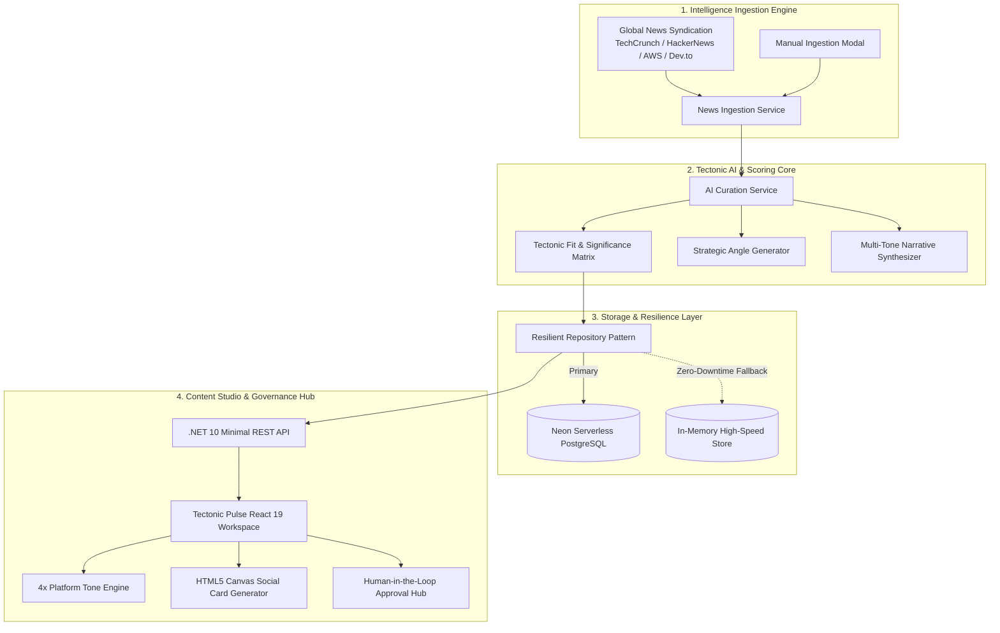

<div align="center">

  <h1>⚡ TECTONIC PULSE</h1>
  <p><strong>Foundation of Future • Next-Gen AI Tech Intelligence & Multi-Platform Curation Engine</strong></p>

  <p>
    <a href="https://tech-update-tectonic.vercel.app/" target="_blank">
      
    </a>
    <a href="https://techupdate-tectonic-api.onrender.com/api/articles" target="_blank">
      
    </a>
    
    
    
    
  </p>

  <h3>
    <a href="https://tech-update-tectonic.vercel.app/">🌐 Explore Live Application</a>
    &nbsp;&nbsp;•&nbsp;&nbsp;
    <a href="https://techupdate-tectonic-api.onrender.com/api/articles">📡 Inspect Live API</a>
  </h3>

  <br />
</div>

---

## 📌 Executive Overview

**Tectonic Pulse** is an enterprise-grade Tech Intelligence, Curation, and Automated Multi-Platform Content Studio developed for **Tectonic**. It synthesizes real-time global engineering breakthroughs, scores their architectural significance, maps them to Tectonic’s core engineering principles, and automatically generates high-impact social media narratives across **LinkedIn, Facebook, and X (Twitter)**.

Designed with **Clean Architecture & Domain-Driven Design (DDD)** on **ASP.NET Core (.NET 10)**, connected to serverless **Neon PostgreSQL**, and served via an ultra-responsive **React 19 & Vite** frontend.

> 🔒 **Proprietary Notice:** The live platform is deployed and fully interactive. To safeguard core commercial IP, proprietary algorithmic weights, scoring matrices, and internal model prompts, this repository serves as the public architectural showcase and technical specification.

---

## 🚀 Live Deployments

| Component | Platform | Status | URL |
| :--- | :--- | :--- | :--- |
| **Frontend Dashboard** | Vercel Edge Network |  | [tech-update-tectonic.vercel.app](https://tech-update-tectonic.vercel.app/) |
| **Backend REST Engine** | Render Cloud Container (.NET 10) |  | [techupdate-tectonic-api.onrender.com](https://techupdate-tectonic-api.onrender.com/) |
| **Database Tier** | Neon Serverless PostgreSQL |  | Distributed AWS Cluster (`ap-southeast-1`) |

---

## 🏛️ High-Level System Architecture



---

## ✨ Core Platform Capabilities

### 1. 🤖 Intelligent Tectonic Fit & Relevance Scoring
* Multi-factor scoring evaluating **Tectonic Fit (68-98%)**, **Industry Importance**, **Trending Velocity**, and **Architectural Relevance**.
* Deep keyword signal analysis targeting modern stacks: `.NET 10, Cloud Native, Autonomous Agents, Zero-Trust, Vector Databases, Microservices`.

### 2. 🎯 Tectonic Strategic Perspective Generator
* Every article is analyzed to produce a tailored **"Tectonic Angle"**:
  * **Why It Matters:** Strategic impact on enterprise engineering teams.
  * **Tectonic Perspective:** Direct statement of how Tectonic builds or resolves the issue.
  * **Key Takeaway:** Actionable takeaway for tech leaders.
* Domain-specific reasoning covering:
  * `AI & Machine Learning`
  * `Cybersecurity & Zero-Day Defense`
  * `Cloud & DevOps Modernization`
  * `Software Architecture & High-Performance Runtimes`
  * `Distributed Database Systems & Vector Storage`
  * `Robotics & Edge Multimodal IoT`

### 3. ✍️ 4-Tier Strategic Social Tone Engine
Instant narrative transformation across 3 platforms (LinkedIn, Facebook in bilingual Bangla, X/Twitter):
* **Executive & Strategic:** C-suite & VP level insights on ROI, governance, and market shifts.
* **Deep Technical:** Systems architecture, runtime benchmarks, memory/latency, and code-level implications.
* **Provocative & Bold:** Candid hot-takes cutting through industry hype and challenging legacy practices.
* **Casual Dev Community:** Relatable, engaging, conversational developer dialogue and memes.

### 4. 🎨 Automated Branded Social Card Generator
* Built-in client-side **HTML5 Canvas Graphics Engine**.
* Generates 1200x630px high-resolution social sharing cards with glowing Tectonic badges, metadata, and custom themes:
  * 🌌 **Cyber Obsidian**
  * 🌆 **Neon Horizon**
  * 🔥 **Tectonic Ember**
  * 🛡️ **Stealth Slate**
* One-click lossless PNG export ready for direct posting.

### 5. 🛡️ Human-in-the-Loop Governance & Scheduling
* Full editorial approval lifecycle (`New Draft` ➔ `Reviewing` ➔ `Approved` / `Scheduled` / `Rejected`).
* Scheduling metadata for content calendars with celebratory confetti animations on approval.

---

## 🛠️ Technology Stack & Engineering Standards

| Area | Technologies Used |
| :--- | :--- |
| **Backend Runtime** | C# 14 / ASP.NET Core (.NET 10.0), Minimal APIs, Native OpenAPI |
| **Architecture** | Clean Architecture (Domain, Application, Infrastructure, Presentation) |
| **Data & ORM** | PostgreSQL (Neon.tech), Entity Framework Core 10, Npgsql |
| **Resilience** | Dual-Tier Resilient Repository with automatic cloud timeout management |
| **Frontend Framework** | React 19, Vite 8, Modern Hooks, Oxlint |
| **Styling & Icons** | Vanilla CSS Glassmorphism Design System, Lucide React Icons |
| **Graphics Engine** | HTML5 Canvas 2D Context Graphic Synthesizer |
| **Deployment** | Docker Container on Render.com, Static Edge on Vercel |

---

## 🔐 Intellectual Property & Proprietary Rights

All software design patterns, proprietary scoring weights, Tectonic angle heuristics, and platform branding are the intellectual property of **Tectonic**.

```
Copyright (c) 2026 Tectonic. All rights reserved.
Unauthorized copying, reverse engineering, redistribution, or commercial use
of the proprietary logic without express written permission is strictly prohibited.
```

---

## 👨‍💻 Author & Lead Engineer

<div align="center">
  <h3><strong>Tahmidul Ahad</strong></h3>
  <p>Lead Engineer & Architect • Tectonic Pulse</p>
  <p>
    <a href="https://github.com/TahmidulAhad" target="_blank">
      
    </a>
  </p>
</div>

---

<div align="center">
  <sub>Architected & Engineered with precision by <strong>Tahmidul Ahad</strong> for <strong>Tectonic</strong> • Foundation of Future</sub>
</div>
